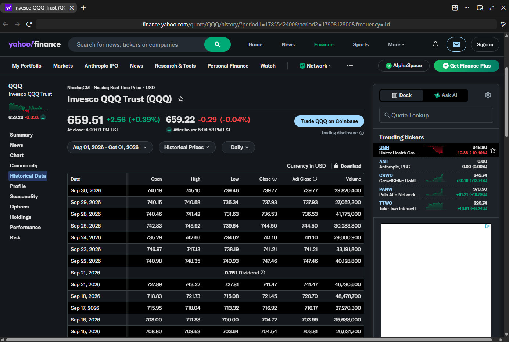
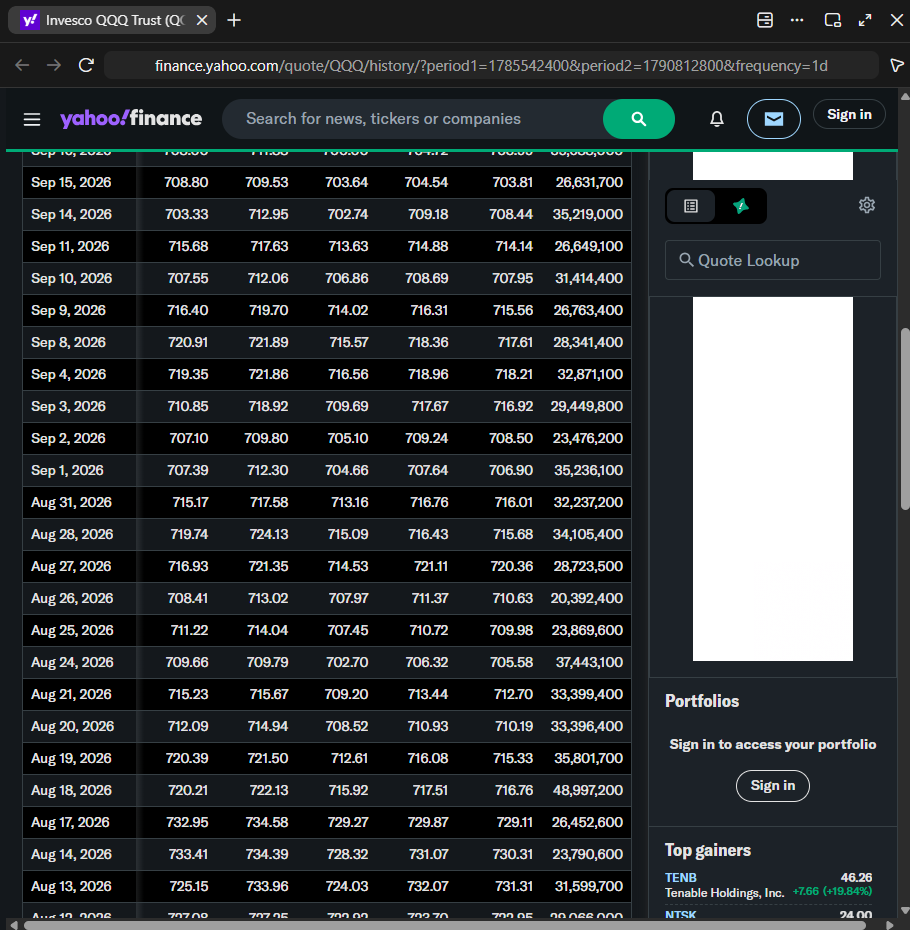
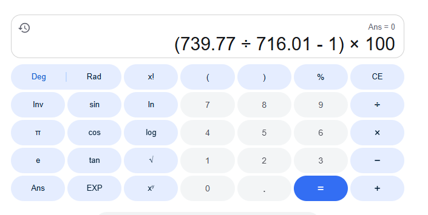
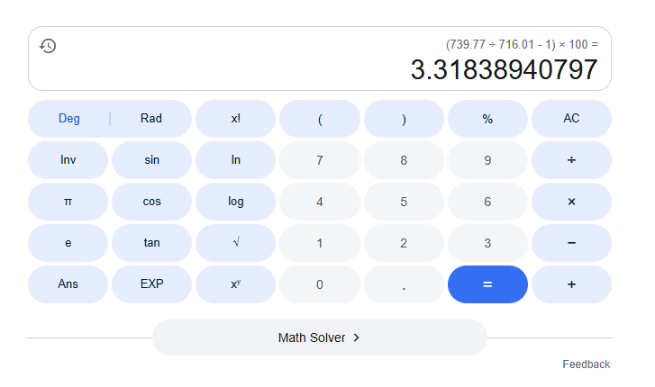

I used OpenAI Codex to organize this evidence form. My personal observations and AI-off responses will be entered by me.

This is an educational course project. It is not financial or investment advice.

# Personal evidence

## Source check

**Status: source screenshots and Matt's calculator check received; access-date confirmation and personal interpretation pending.**

On November 18, 2026, Matt supplied two screenshots of Yahoo Finance's QQQ daily historical prices. The images are preserved unchanged below. Codex transcribed the visible values and compared them with the archived input file. Matt then supplied screenshots of his calculator input and result, retained below. Codex supplied the formula earlier and verified the arithmetic afterward; the calculator execution is Matt's evidence and is separate from the AI-off prediction requirement.

[Yahoo page shown in both screenshots](https://finance.yahoo.com/quote/QQQ/history/?period1=1785542400&period2=1790812800&frequency=1d) · [Archived prices](../data/prices.csv) · [Original source ledger](../data/source-ledger.json)

| Observation date | Screenshot Adj Close (USD/share) | Archived QQQ adjusted close (USD/share) | Comparison |
|---|---:|---:|---|
| August 31, 2026 | 716.01 | 716.013916015625 | Matches when rounded to cents |
| September 30, 2026 | 739.77 | 739.77001953125 | Matches when rounded to cents |

The September image identifies QQQ, USD, Daily frequency, column headings and the September 30 row. The August image shows the August 31 row at the same page URL; column positions are interpreted using the first image. August's unadjusted Close is 716.76, whereas its Adj Close is 716.01. The adjusted-close field is the one the model uses.

| Field | Evidence / remaining personal entry |
|---|---|
| Date received | November 18, 2026; exact capture/access date is not visible and remains unconfirmed |
| Source and input | Yahoo Finance QQQ daily historical data; adjusted close, USD per share |
| Values visible in Matt's screenshots | August 31: 716.01; September 30: 739.77 |
| Comparison performed by Codex | Both observations match the October 22 archive to the source's displayed cent precision |
| Matt's calculator check | (739.77 / 716.01 - 1) x 100 = 3.31838940797%, or +3.32% for September; input and result screenshots supplied |
| Matt's explanation of any match or difference | Pending personal response; no difference visible at cent precision |
| Effect on Matt's decision | Pending personal response |

This sample supports two month-end observations. It does not verify every fund or date, the entire annual estimate, or future performance. QQQ's estimated return affects the target constraint, so this check concerns a portfolio input. The separate [automated CPI comparison](../outputs/source-check.json) supplies additional evidence; the CPI reserve floor is slack at base.

### Matt's response — November 18, 2026

Yes, I checked Yahoo today. Since the number were aligned with what my algorithm has come up with, this actually makes more way more confident to proceed, especially when it is using the correct data. I still want to pilot it.

### Screenshots supplied by Matt

Original screenshots are retained without editing. The AI disclosure and educational-use notice at the top of this record apply to the organization and explanation of these attachments.

**September 30 observation, including column headings**

**August 31 observation on the same historical-data page**

### Calculator evidence supplied by Matt

The first image shows the formula entered. The second shows the evaluated result, **3.31838940797**. Because the formula multiplies by 100, the result is **3.31838940797%**, a positive September monthly return.

**Codex arithmetic cross-check:** the cent-rounded source values reproduce Matt's result. The full-precision archived prices produce 3.31782706792%, a difference of 0.00056234005 percentage points due to rounding the prices. Both results round to **3.32%**. No input-file or model change is needed for this rounding difference. This explanation is supplied by Codex; Matt's interpretation and effect on his decision remain open above.

File fingerprints identify the exact attachments preserved here; they do not establish when the screenshots were captured.

| File | SHA-256 |
|---|---|
| qqq-source-2026-09-30.png | edbfc331736c756de5c98c8a60fdbe5ffecbc6cb0843574b59515be82f90e8fc |
| qqq-source-2026-08-31.png | 4272cb7b5f55ab2674311f9f2cc073d4efe01abade3d7a8fbe7dd24ceea0e669 |
| qqq-return-calculator-input.png | 77702fc22ec8c384e127598d44498297519939447499586e7f8398409348e5ae |
| qqq-return-calculator-result.png | 049965bc82b82138548bcb882040a47903e905d033bff7172a3f2f93f2986292 |

## Highest-risk claim and three possible failures

Matt supplied his claim, evidence, three failures with detection methods, and conclusion on November 19 after receiving the test result. His full wording is preserved in [his reflection](highest-risk-claim.md), with separately labeled verification notes. This does not replace the locked prediction. Matt clarified on November 19 that any one condition triggers reconsideration, with BIL below 55%. The [dated clarification](highest-risk-claim.md) records this; the separate 7.6% versus observed-volatility note remains for review.

| Field | Matt’s response |
|---|---|
| Highest-risk claim I am making | Supplied; see My Highest-Risk Claim in [the unchanged reflection](highest-risk-claim.md) |
| Evidence supporting it | Supplied; see Evidence paragraph in [the unchanged reflection](highest-risk-claim.md) |
| Failure possibility 1 and how I would detect it | Supplied; see Failure 1: switching-cost calculation in [the unchanged reflection](highest-risk-claim.md) |
| Failure possibility 2 and how I would detect it | Supplied; see Failure 2: estimated stock-return contribution in [the unchanged reflection](highest-risk-claim.md) |
| Failure possibility 3 and how I would detect it | Supplied; see Failure 3: estimation-window stability in [the unchanged reflection](highest-risk-claim.md) |
| My conclusion and the condition that changes it | Supplied; see Conclusion: cautious pilot and stated conditions in [the unchanged reflection](highest-risk-claim.md) |

The [Locked Changed-Input Record](validation-and-ai-use.md) now links the November 19 prediction committed before execution and the [15 bp result and comparison](cost15-prediction-comparison.md). The original prediction is preserved.

## Recording evidence

Keep your face visible in every video. Record from the final app and use the two disclosures at the start. Correct the transcript after listening to the actual recording.

| Item | Status |
|---|---|
| Video 1, at most 3 minutes | Link and corrected transcript pending |
| Video 2, at most 5 minutes | Link and corrected transcript pending |
| Video 3, at most 5 minutes, opens on the live app | Link and corrected transcript pending |
| Instructor access to repository and videos | Unconfirmed |
